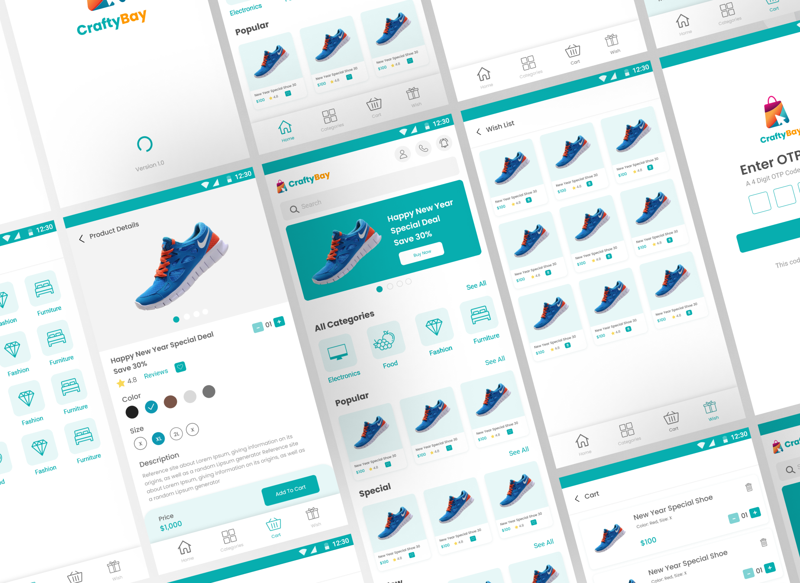

# CraftyBay

A modern cross-platform eCommerce application built with Flutter.

---

## 🚀 Key Features

* **Feature-First Architecture:** Modular and scalable code structure for easy maintenance.
* **State Management:** Powered by **GetX** for predictable, reactive UI updates and efficient dependency management.
* **RESTful API Integration:** Seamless network requests managed via the **http** package.
* **Flexible Payments:** Integrated support for **Stripe Card Payments** and **Cash on Delivery (COD)**.

---

## 📱 Application UI



---

## 🛠️ Getting Started

### Prerequisites

Ensure you have the following installed on your machine:
* [Flutter SDK](https://docs.flutter.dev/get-started/install) (latest stable version)
* Dart SDK

### Installation

1. **Clone the repository:**
   ```bash
   git clone [https://github.com/Hasibol-Hoda-Inu/craftybay.git](https://github.com/Hasibol-Hoda-Inu/craftybay.git)
   cd craftybay
